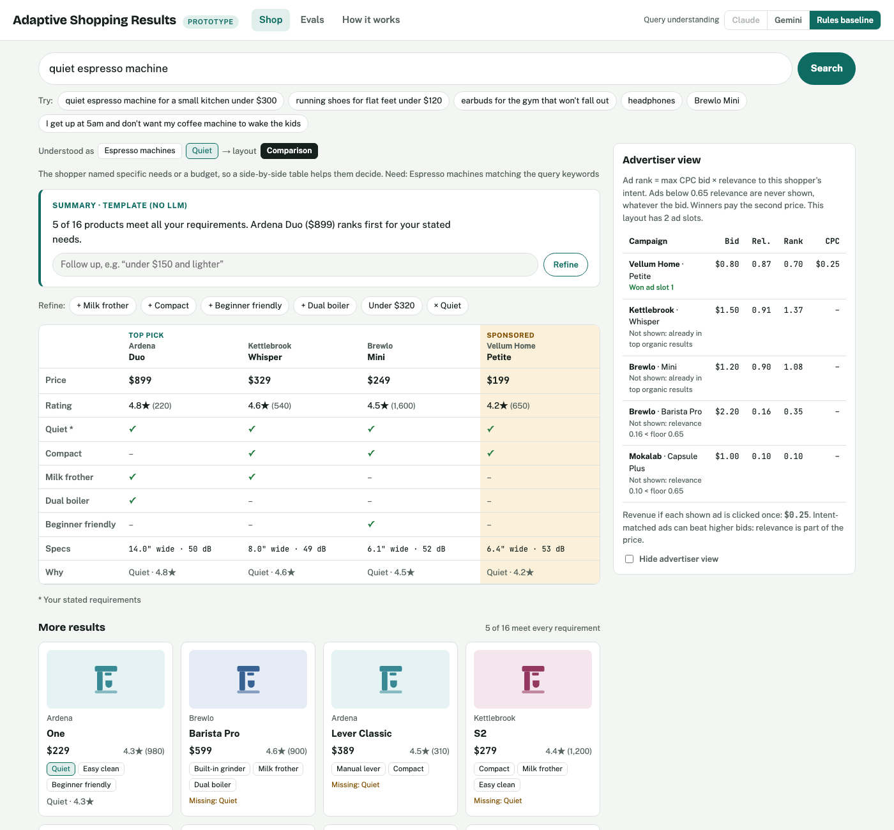
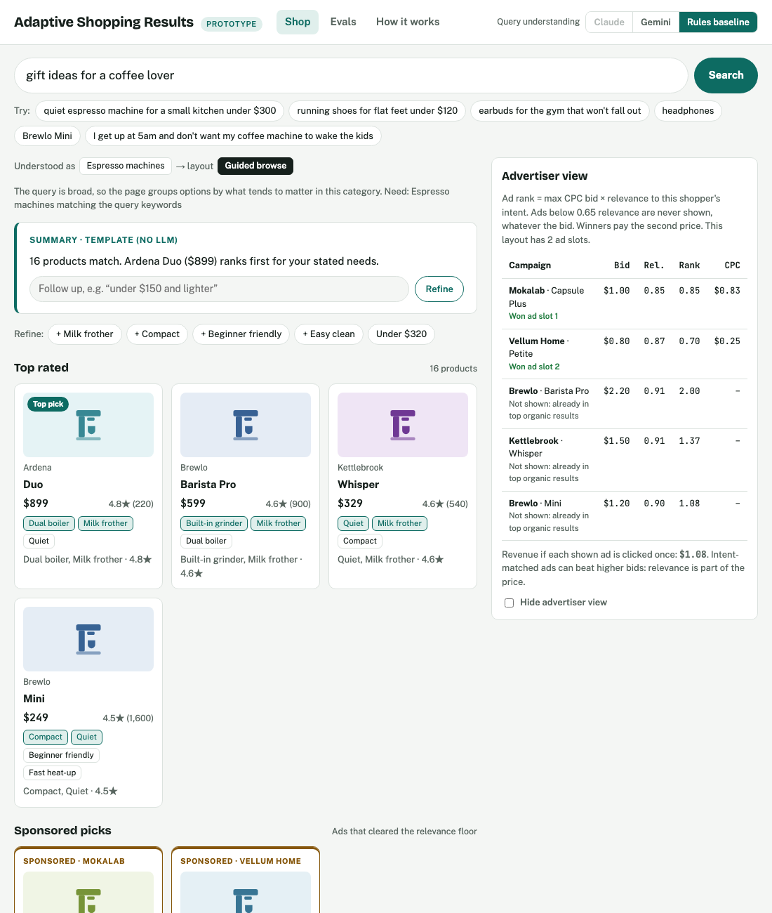
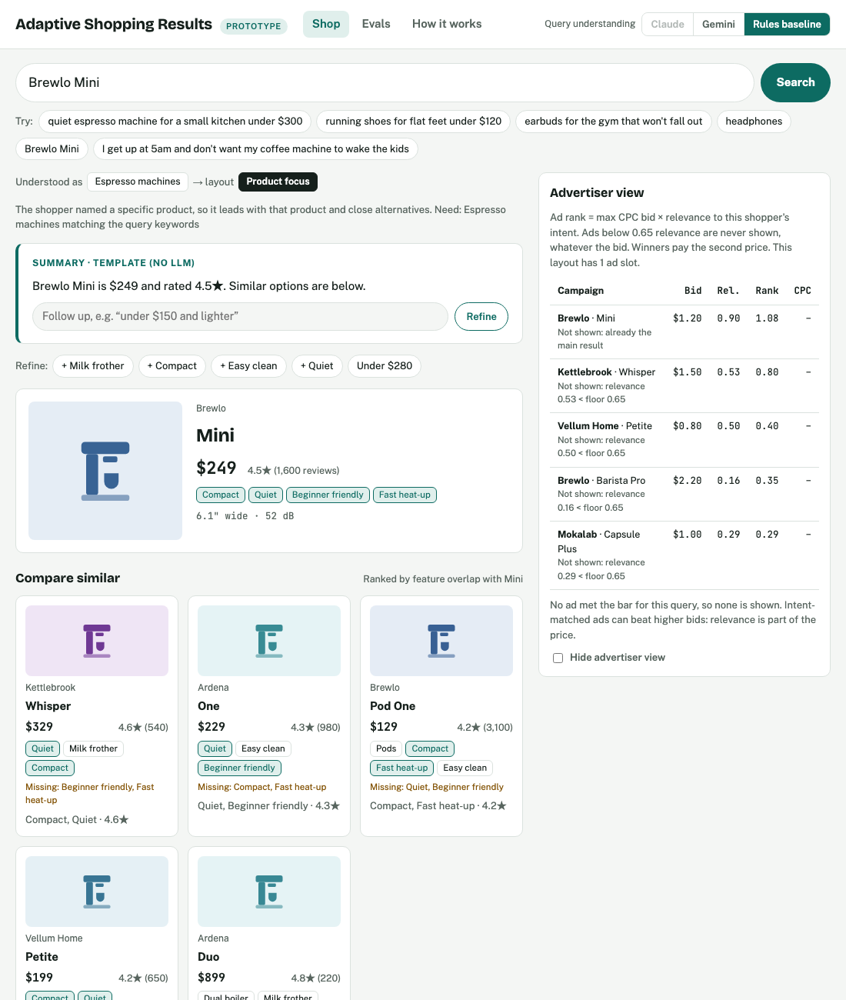
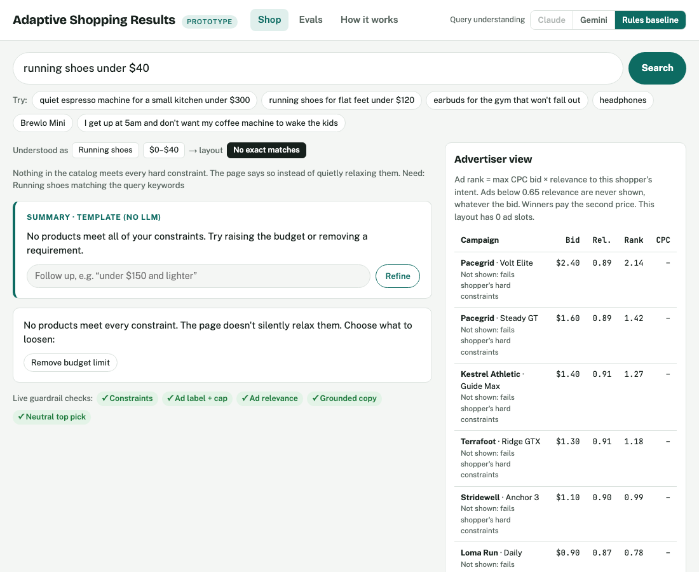

# Adaptive Shopping Results

> An AI shopping search prototype. Shoppers describe what they need in their own words, and the results page changes shape to fit what they mean. Sponsored products are labeled, blended with organic results, and priced on relevance as well as bid.

**[Try the live demo](https://askeladden00.github.io/adaptive-shopping-results/prototype/)** (rules baseline, or Gemini with your own key) · **[Claude version](https://claude.ai/artifact/1Co4jhFhPcwG2AGrXQkYSh)** (needs a claude.ai account) · **[Eval write-up](evals/README.md)**



*"quiet espresso machine": the sponsored column is labeled, and a $0.80 bid with relevance 0.87 wins the ad slot while a $2.20 bid with relevance 0.16 never shows.*

A product case study in AI-powered shopping and ads experiences on search, built with Claude Code. All products, brands and ad campaigns are fictional.

---

## What it is

Shoppers often know their situation, not the product spec: "my arches collapse" means *stability shoe*, and "I don't want my coffee machine to wake the kids" means *quiet espresso machine*. Keyword search misses that, and a list of ten links is the wrong page for many intents.

Here an LLM turns the shopper's words into a structured intent. Deterministic code then retrieves and ranks products, runs the ad auction and picks one of four page layouts:

| Shopper intent | Page |
|---|---|
| States needs or a budget ("quiet, small kitchen, under $300") | **Comparison** table, checked against each stated need |
| Broad ("gift ideas for a coffee lover") | **Guided browse**, grouped by what splits the category |
| Names a product ("Brewlo Mini") | **Product focus**, then close alternatives |
| Nothing matches ("running shoes under $40") | **No exact matches**, with buttons to choose what to loosen |

## Who it's for

- **Shoppers** who describe their situation instead of a spec. They get fewer rewritten searches and a page shaped for the decision they're making.
- **Advertisers** who want to reach intent, not just keywords. Ad rank is bid × relevance to the parsed intent, so a relevant product can beat a higher bid on an irrelevant one. A product already ranking organically can't also win an ad slot, so advertisers don't pay for traffic they already earn.
- **The ads business**, which depends on shopper trust inside AI answers. Ads are always labeled, capped by layout, and never placed by the LLM.

## Results at a glance

Evaluated with my [AI Evals framework](https://github.com/askeladden00/AI-Evals): 41 hand-labeled queries, five code guardrails on every page, an LLM judge, and release gates that decide SHIP or HOLD.

| | Rules baseline | Claude v1 | Claude v4 (final) |
|---|---|---|---|
| Exact intent accuracy, held-out (15 cases) | 33% | 93% | **93%** |
| Guardrails pass on every case | 100% | 71% | **100%** |
| LLM summaries grounded in page data | n/a | 71% | **100%** |
| Judge helpfulness (1–5) | n/a | not run | 4.68 |
| Verdict | HOLD | HOLD | **SHIP** |

Four rounds of error analysis took Claude from v1 to v4; two of the fixes were bugs in the evaluator itself, not the product. Full method and iteration story: **[evals/README.md](evals/README.md)**.

## Start here (5 minutes)

1. **Try it:** open the [live demo](https://askeladden00.github.io/adaptive-shopping-results/prototype/) and tap the example queries. Keep the **Advertiser view** panel open to see why each ad won or lost.
2. **Read the problem:** [docs/problem-and-users.md](docs/problem-and-users.md) and [docs/advertiser-value.md](docs/advertiser-value.md).
3. **Read the evals:** [evals/README.md](evals/README.md): failure taxonomy, release gates, and how each iteration was diagnosed.

## How this repo is organized

```
adaptive-shopping-results/
├── README.md                  ← this page
├── docs/
│   ├── problem-and-users.md   ← the shopper problem and the four page layouts
│   ├── advertiser-value.md    ← relevance-priced auction and ad policy
│   ├── how-it-works.md        ← what the LLM does vs. what code does, and the engines
│   └── next-steps.md          ← what I'd do next, including online A/B metrics
├── evals/
│   ├── README.md              ← evaluation method, gates, results, iteration log
│   └── runs/                  ← exported results of every eval run
├── prototype/
│   ├── README.md              ← how to run it, and a code map
│   ├── index.html             ← the app (open in a browser, no build step)
│   ├── src/                   ← catalog, engine, LLM layer, evals, UI
│   └── scripts/               ← Gemini API key and model check
└── assets/screenshots/        ← the screens shown in these docs
```

## Screens

| Guided browse | Product focus | No exact matches |
|---|---|---|
|  |  |  |

Screenshots use the rules baseline engine, so the summaries are template text; in the [Claude version](https://claude.ai/artifact/1Co4jhFhPcwG2AGrXQkYSh) they're LLM-written and checked against the page.

## A note on data and evidence

- **All data is fictional:** 48 products, their brands and 16 ad campaigns were written for this project. No real merchant, advertiser or employer data.
- **Eval labels are mine.** The held-out set was written after the prompt and rules were frozen, but it's small (15 cases) and labeled by one person, and each version was run once. The judge is from the same model family as the generator, so its score is directional. [Next steps](docs/next-steps.md) covers what a stronger eval would need.
- **Gemini is supported but not yet evaluated.** Two Gemini runs stopped on free-tier limits; both are kept in [evals/runs/](evals/runs/) as an honest record.
